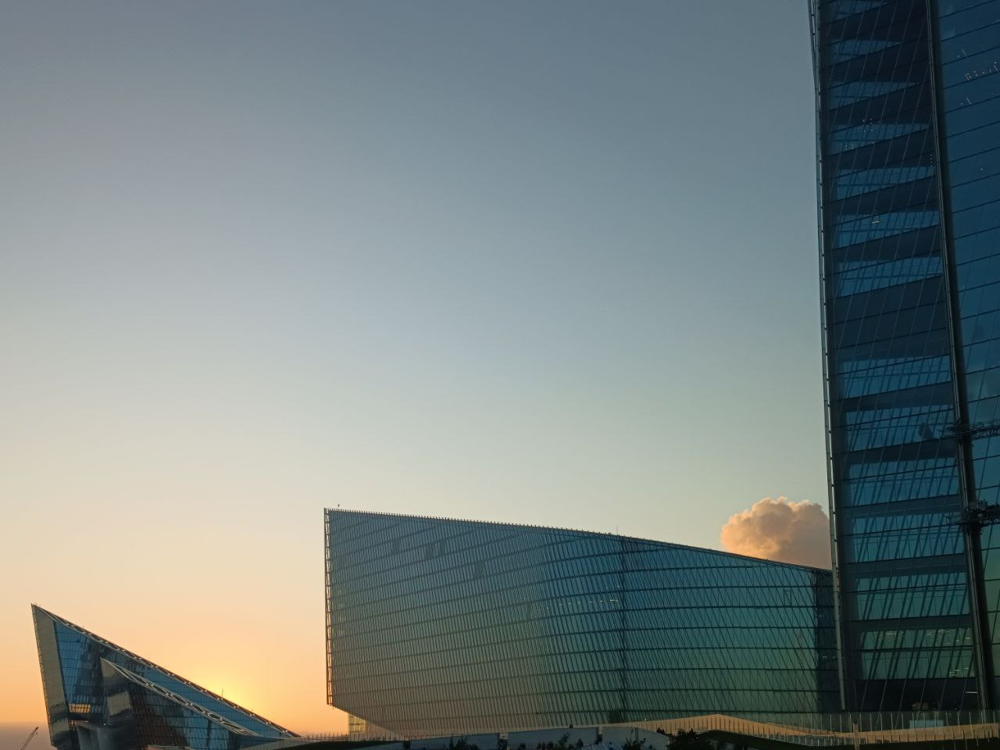
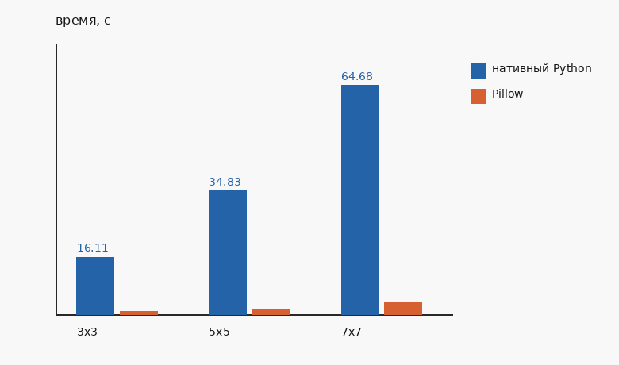

# Лабораторная работа 1. Медианный фильтр

Вариант 4: медианный фильтр с переменным размером ядра.

Один и тот же алгоритм сделан дважды: вручную на Python и через Pillow 10.2.0.

Запуск из папки lab1: `python3 main.py`.

Фото задано в main.py константой IMAGE_PATH: source/photo.jpg. На него сажается шум «соль и перец» (8%), затем фильтр считается для ядер 3, 5 и 7. Картинки и график пишутся в results/.

## 1. Теоретическая база

Медианный фильтр заменяет каждый пиксель на середину значений в квадратном окне вокруг него.

- Сторона окна k нечётная: 3, 5, 7. Тогда в окне 9, 25 или 49 чисел, и середина одна.
- Числа окна сортируются. В результат берётся средний по счёту элемент.
- Одинокая чёрная или белая точка оказывается в начале или в конце списка и в пиксель не попадает.
- Крупная граница при этом сохраняется: по одну сторону окна свои значения, по другую свои.
- Чем больше окно, тем крупнее пятна шума оно убирает. Углы и тонкие линии при этом портятся: в окне угла большинство пикселей уже принадлежит фону.
- Цвет обрабатывается по каналам отдельно: своё окно у красного, своё у зелёного, своё у синего.
- У края кадра нехватающие места окна заполняются копией крайнего пикселя.

## 2. Описание разработанной системы

Два файла:

- median_filter.py считает фильтр;
- main.py читает фото, добавляет шум, замеряет время и сохраняет картинки.

Нативный фильтр, median_filter_native:

- проверяет, что картинка имеет тип uint8, а ядро — положительное нечётное целое;
- для серой картинки считает один слой;
- для цветной вырезает красный, зелёный и синий и считает каждый слой отдельно, затем склеивает их обратно;
- по краю слоя добавляет рамку повторением крайнего пикселя;
- для каждого пикселя собирает значения окна в список, сортирует и берёт середину.

Библиотечный фильтр, median_filter_pillow:

- те же проверки картинки и ядра;
- переводит массив в картинку Pillow;
- вызывает MedianFilter с тем же размером окна;
- Pillow применяет фильтр к каждому каналу отдельно и считает его в коде на C;
- результат переводится обратно в массив.

main.py:

- открывает source/photo.jpg и переводит его в RGB;
- портит копию шумом: часть пикселей становится чёрной, часть белой;
- для каждого ядра из списка 3, 5, 7 вызывает оба фильтра и засекает время только вокруг вызова;
- сравнивает пиксели двух результатов;
- сохраняет исходник, шум, оба результата и график времени.

## 3. Результаты работы и тестирования системы

Фото RGB, 1280 на 960. Шум 8%. Ядра 3, 5 и 7.

Исходное фото и шум:

Нативный фильтр, ядра 3, 5 и 7:

Pillow для тех же ядер записал те же файлы: pillow_k3.png, pillow_k5.png и pillow_k7.png побайтно совпали с нативными.

Время одного прогона, секунды нативного кода подписаны на графике:

- ядро 3: 16.11 с;
- ядро 5: 34.83 с;
- ядро 7: 64.68 с.

Оранжевые столбики на графике — Pillow. Они намного ниже синих.

Что видно по картинкам и графику:

- после шума кадр покрыт чёрными и белыми точками;
- ядро 3 убирает почти все точки, контуры зданий остаются;
- отдельные точки ещё видны там, где несколько шумовых пикселей попали в одно окно;
- ядро 7 поле чистит сильнее, сетка фасада и мелкие края становятся мягче;
- время нативного кода растёт вместе с окном: 16.11 с, затем 34.83 с, затем 64.68 с;
- Pillow на том же кадре остаётся заметно быстрее, потому что окно считается в коде на C.

Повторный запуск даёт те же пиксели при том же seed и близкое, но не то же самое время.

## 4. Выводы по работе

- Медианный фильтр убирает шум «соль и перец»: выброс оказывается на краю отсортированного окна.
- Размер ядра — компромисс. Маленькое окно бережёт детали, большое дочищает шум и смягчает мелкую сетку на фото.
- Своя реализация и MedianFilter из Pillow дали одинаковые картинки.
- Свой цикл на Python на этом фото занял от 16 до 65 секунд. Для проверки алгоритма этого достаточно, для большого кадра удобнее библиотечный вызов.

## 5. Использованные источники

- Google: Медианный фильтр как способ убрать импульсный шум.
- Pillow 10.2.0, модуль PIL.ImageFilter: классы MedianFilter и RankFilter, метод Image.filter.
- NumPy 1.26.4, numpy.pad с mode="edge": дополнение кадра повторением крайних пикселей.
